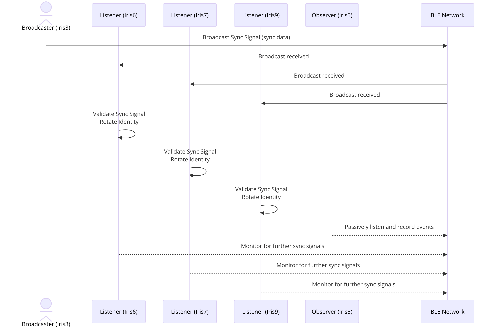
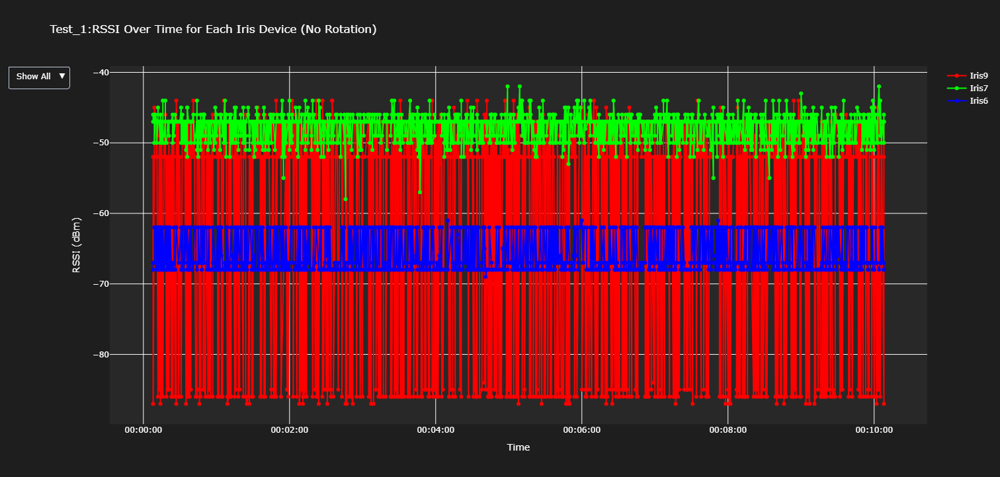
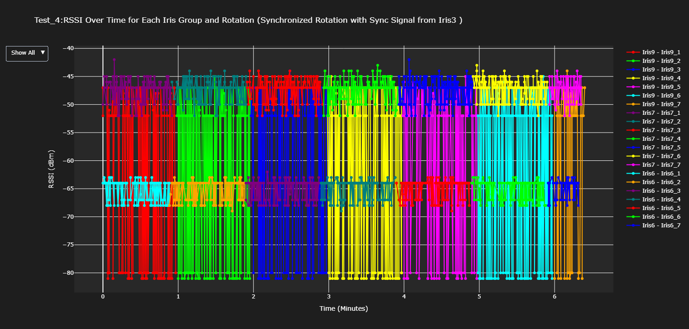
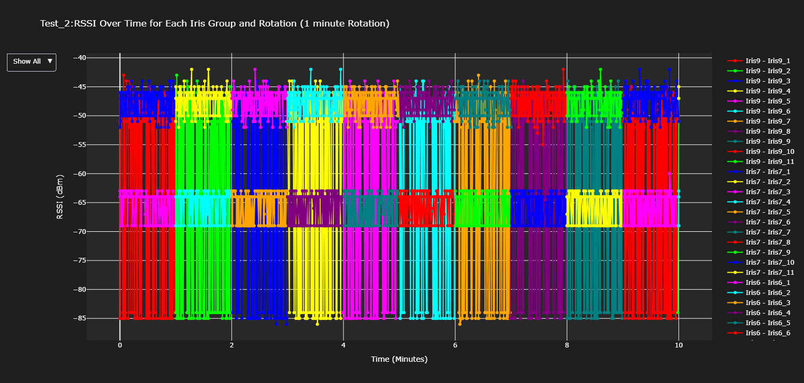
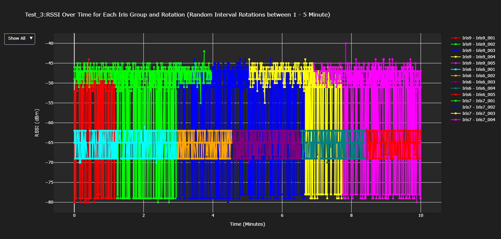
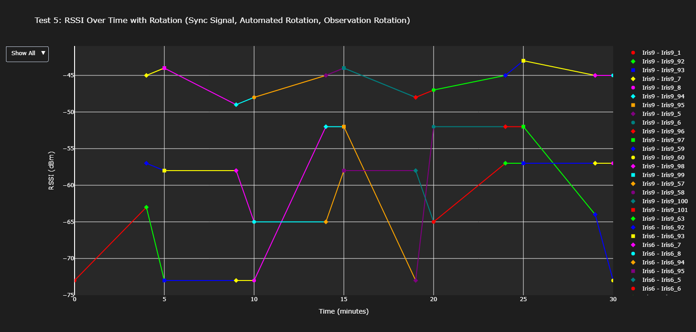
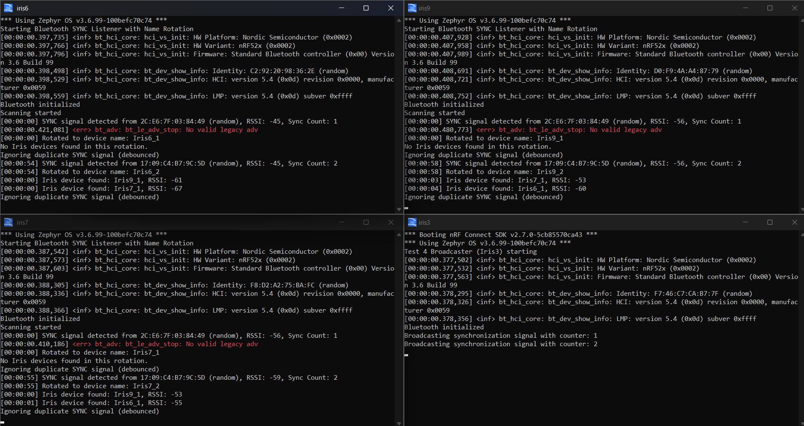

# BLE Witness Protection Protocol

Can a group of Bluetooth Low Energy devices hide from a passive tracker by changing identity together?

This project is a hardware testbed and a set of experiments for that question. Five nRF52840 boards (named Iris3, Iris5, Iris6, Iris7 and Iris9) run firmware that changes their advertised Bluetooth name on a schedule or on a shared sync signal, while one board records what an outside observer would see. Five rotation strategies were built and compared.

**Read the full write-up:** [Technical report](docs/TECHNICAL-REPORT.md), covering the motivation, the math, the five tests and the results.

## Findings and limits

- Coordinating the change works. In Test 4, the three listeners changed to their new names within about a second of each other at every rotation measured.
- Changing names together does not hide the devices by itself. Signal strength (RSSI) still ties each new name to the old one.
- The devices rotated the advertised **name**, not the Bluetooth **address**. This was a deliberate shortcut, because address handling is built into Zephyr's Bluetooth stack, and it means the results show the coordination logic rather than a complete privacy guarantee.
- The sync counter in Test 5 is obfuscated with a single-byte XOR. That is a placeholder for real encryption, not security.
- The evaluation is observational (logs and RSSI graphs). No tracking attack was implemented and measured.
- The Test 5 peer-rotation trigger was added after the original 2024 tests and checked only with a logic model, not run on hardware.
- The graphs for Tests 1 to 4 came from observer logs that are not published, so they can't be regenerated from this repository (see [DATA.md](DATA.md)).

## The problem

BLE devices advertise an identifier that any nearby scanner can read, which makes them easy to track. Address randomisation (Resolvable Private Addresses, RPAs) was introduced to prevent this, but research has shown that devices can still be correlated through timing and signal strength. Prior work synchronised address rotation between a single central and a single peripheral. This project looks at the gap: **multi-peripheral piconets**, where one central device talks to several peripherals, and how their identity changes can be coordinated.

## The approach: a "witness protection" protocol

The name comes from witness protection: someone at risk is given a new name and a new place, so that anyone who knew the old identity can no longer find them. Here, a BLE device gets a new advertised name (for example `Iris9_1` then `Iris9_2`), and the devices change together so that the old and new identities are hard to match up.

### Hardware and roles

Five Raspberry Pis, each controlling an **nRF52840 DK** over a SEGGER J-Link:

| Node | Role | Behaviour |
|------|------|-----------|
| **Iris3** | Broadcaster | Sends periodic `SYNC` advertisements with a counter (obfuscated in Test 5) that coordinate rotation |
| **Iris6, Iris7, Iris9** | Listeners / peers | Rotate identity on sync, and scan for each other's rotations |
| **Iris5** | Passive observer | Logs all advertising traffic as an independent outsider's view |



### The five tests

| # | Strategy | Firmware | Results |
|---|----------|----------|---------|
| 1 | **No rotation**: static identity (baseline) | [firmware/test1-no-rotation](firmware/test1-no-rotation) | [results/test1](results/test1) |
| 2 | **Fixed-interval rotation**: every 60 s, independently | [firmware/test2-fixed-interval-rotation](firmware/test2-fixed-interval-rotation) | [results/test2](results/test2) |
| 3 | **Random-interval rotation**: every 1 to 5 min | [firmware/test3-random-interval-rotation](firmware/test3-random-interval-rotation) | [results/test3](results/test3) |
| 4 | **Synchronized rotation**: listeners rotate on the broadcaster's `SYNC` signal, with debouncing | [firmware/test4-synchronized-rotation](firmware/test4-synchronized-rotation) | [results/test4](results/test4) |
| 5 | **Hybrid rotation**: sync signal with an XOR-obfuscated counter, an autonomous 5-minute timer, and peer-observed rotation | [firmware/test5-hybrid-rotation](firmware/test5-hybrid-rotation) | [results/test5](results/test5) |

## Results

RSSI over time for each device, as recorded by the observer. **Test 1** has a static identity throughout; **Test 4** shows all three listeners changing identity together on each sync signal.

| Test 1: no rotation | Test 4: synchronized rotation |
|---|---|
|  |  |

| Test 2: fixed interval | Test 3: random interval |
|---|---|
|  |  |

Test 5, a 30-minute run (circles are sync-signal rotations, diamonds are peer-observed, squares are autonomous):



The four serial terminals during a Test 4 run (Iris6, Iris9, Iris7 listeners and the Iris3 broadcaster):



## Repository layout

```
firmware/    C firmware (Zephyr RTOS / nRF Connect SDK) for every device and every test iteration,
             plus compiled .hex images and the early prototypes that led up to the tests
analysis/    Python scripts that parse the serial logs and produce the RSSI-over-time graphs
results/     Serial logs from the project's own nodes, parsed data, and generated graphs, organised per test
docs/        Technical report and design diagrams
```

See [firmware/README.md](firmware/README.md) for a guide to every firmware folder (which is which, and how the iterations relate) and [analysis/README.md](analysis/README.md) for the scripts.

## Toolchain

- **Boards:** Nordic nRF52840 DK (`nrf52840dk/nrf52840`)
- **SDK / RTOS:** nRF Connect SDK v2.7.0, Zephyr RTOS (v3.6.99)
- **Language:** C (firmware); Python with pandas, matplotlib, plotly and numpy (analysis)
- **Flashing / monitoring:** SEGGER J-Link via `west flash` (or nRF Connect for VS Code); serial output captured with `screen` on each Raspberry Pi

### Building and flashing a firmware folder

Each firmware folder is a standard Zephyr application (`CMakeLists.txt`, `prj.conf`, `src/main.c`) and can be built from an nRF Connect SDK v2.7.0 environment:

```bash
west build -b nrf52840dk/nrf52840 firmware/test4-synchronized-rotation/listener-v3
west flash
```

The `.hex` files in each folder's `images/` directory are prebuilt outputs kept for convenience and can be flashed directly.

## Data handling

The passive observer (Iris5) records every BLE advertisement in range, which includes devices belonging to other people. For that reason the raw observer logs and the screen recordings of the test runs are **not published** in this repository. The graphs generated from them are included, along with the logs from the project's own nodes and the parsed datasets. See [DATA.md](DATA.md) for details.

Local account names were also removed from a few file paths in the analysis scripts (now plain filenames, read from the working directory) and from the window titles in one screenshot. The affected files are marked in [docs/provenance/MANIFEST.csv](docs/provenance/MANIFEST.csv), which also records each file's origin, original timestamp and checksum.

## License

Apache License 2.0. See [LICENSE](LICENSE) and [NOTICE](NOTICE), which also credits the Intel, Nordic and Zephyr sample code that parts of the firmware were adapted from.

## Author

**JeganFM**
